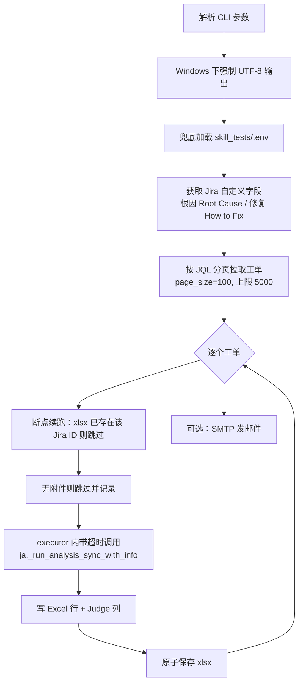

# 生产端详解：`process_skills/`

> 目录：`Rubick/backend/tests/skill_tests/process_skills/`
> 角色：**按 JQL 批量分析 Jira 工单**，并把结果导出 xlsx；同时对外提供 Skill 管理 / 任务管理的 FastAPI 服务。

---

## 1. 目录结构

```
process_skills/
├── run_jql_with_skill_demo.py              # 核心分析脚本（可独立 CLI 运行）
├── llm_judge_agent_comment_accuracy.py     # 大模型结论 vs 人工结论 的判定模块
├── skills_tasks.yaml                       # 定时任务定义（cron + 预设参数）
├── server_requirements.txt                 # FastAPI 服务依赖
├── start_backend_server.bat                # 单独启动后端（Windows）
├── server/                                 # FastAPI 服务包
│   ├── __init__.py
│   ├── main.py          # FastAPI 应用与全部 HTTP 接口
│   ├── config.py        # 路径 / 环境变量 / 密钥
│   ├── storage.py       # JSON / YAML 落盘（原子写 + 锁）
│   ├── skills_mgr.py    # Skill 扫描、上传、审核、文件树、通知
│   └── executor.py      # 任务调度、子进程执行、进度/结果处理
└── server_data/         # 运行期数据（自动创建，见 data-and-storage.md）
```

---

## 2. `run_jql_with_skill_demo.py` —— 核心分析脚本

整个系统的「发动机」。既被用户手动 CLI 调用，也被后端 `executor.py` 以子进程方式调用。

### 2.1 路径与依赖定位（**改目录布局前必读**）

```python
_HERE   = Path(__file__).resolve().parent   # process_skills/
_RUBICK = _HERE.parents[3]                  # Rubick/
_PROJECT = _RUBICK.parent                   # 上层项目根
_AMLAGENT = _RUBICK / "AmlAgent"
for _p in [str(_RUBICK), str(_AMLAGENT), str(_HERE)]:
    sys.path.insert(0, _p)

import backend.api.jira_analysis as ja         # 提供 _run_analysis_sync_with_info
import backend.api.batch_jql_runner as batch   # 提供 _get_jira_issue_info 等

# 结论判定模块（agent 分析 vs Jira 真实根因），移植自 pmlist_niko_labeller
from llm_judge_agent_comment_accuracy import run_agent_analysis_judge_for_jira
```

> **注意**：源码里有一行注释「每次要手动更新 `jira_analysis` 到 `jira_analysis_for_skills.py`」，说明该脚本依赖的 `backend.api.jira_analysis` 可能与 `Rubick` 主干不同步，**改动分析能力时要留意这两处**。

脚本启动时会**为一批后端可选依赖打 `MagicMock` 桩**（在真正 `import` 之前），目的是让脚本在前端/后端依赖不齐时也能 import 成功。当前被 mock 的模块清单（`_OPTIONAL_DEPS`）：

```
jose / passlib / ldap3 / psycopg2 / smolagents / litellm / apscheduler / pytz
```

**新增对 `backend.*` 的依赖前，先确认它不在上面这份 mock 清单里**，否则拿到的会是 MagicMock 而非真实实现。

### 2.2 执行主流程



### 2.3 CLI 参数

| 参数 | 说明 | 默认 |
|---|---|---|
| `--jql` | JQL 查询语句 | 取 `.env` 的 `RUN_JQL_QUERY` |
| `--output` | 输出 xlsx 路径 | 自动生成 `skills_result_output/...` |
| `--max_issues` | 最多处理工单数 | 不限 |
| `--max_rounds` | 单个工单 AI 分析最大轮次 | 透传给分析器 |
| `--timeout` | 单个工单分析超时（秒） | 透传 |
| `--email` | 完成后发送结果的收件人 | 取 `.env` 的 `BATCH_ANALYSIS_EMAIL` |
| `--skill` | **指定使用的 Skill 名** | 未指定则用默认分析 |

> `--skill` 传入的 Skill 名称若**包含 `display`**（如 `aml-display-debug`），脚本判定为「显示型 Skill」（`is_display_skill`），结果会**额外写入 3 列**（`SKILL定位Owner` / `JIRA Component` / `JIRA Assignee Owner`）。判断逻辑见 `"display" in args.skill.lower()`。

### 2.4 输出 xlsx 的列（`headers`）

顺序固定，**新增列必须同时改这里和前端 `lib/columns.ts`**：

```
Jira ID, Summary, Description,
Root Cause, How to Fix,
Raw, Final, Judge Verdict, Judge Reason, Judge Aligned, Judge Conflict, Judge Real Result
（+ 显示型 Skill 时）SKILL定位Owner, JIRA Component, JIRA Assignee Owner
```

### 2.5 工程细节（坑点）

- **断点续跑**：每写完一行就原子保存；重跑时按 Jira ID 去重跳过。
- **并发写安全**：写 xlsx 用「写临时文件 → `os.replace` 原子替换」，避免中断导致文件损坏。
- **进度输出**：每处理完一个工单打印 `[i/N] 描述`，后端 `executor.py` 靠这行正则解析进度。
- **单工单超时**：在 ThreadPoolExecutor 中执行，超时抛错只影响该行，不中断整体。
- **Windows 控制台**：启动时 `sys.stdout.reconfigure(encoding="utf-8")`，中文不乱码。

---

## 3. `llm_judge_agent_comment_accuracy.py` —— 结论判定模块

判断「大模型对工单根因的分析」与「人工最终结论」是否一致，产出 xlsx 里的 `Judge *` 系列列。

### 3.1 对外函数

| 函数 | 作用 |
|---|---|
| `read_jira_issue_fields(...)` | 从 Jira 工单读取 summary / description / 根因 / 修复 / **comments**（只保留 `nan.li`、`lingzhi.bi`、`aml-agent` 三位作者的评论，并做超长截断） |
| `analyze_jira_issue_with_llm(...)` | 调大模型得到真实结论 `real_result` 与 `root_cause_known`（提示词 `JIRA_SUMMARY_INSTRUCTIONS`） |
| `compare_real_result_with_agent_analysis(...)` | 对比 Agent 分析与人工真实结论，产出 `verdict`（提示词 `JIRA_COMPARE_INSTRUCTIONS`） |
| `run_agent_analysis_judge_for_jira(...)` | 编排上面三步，返回判定结果 |

### 3.2 判定取值（与前端统计口径必须保持一致）

`verdict` 原始文字归一后落入 4 类：**命中（命中根因）/ 相关 / 错误 / 未知**。归一规则见前端 [`lib/stats.ts` 的 `classifyVerdict`](../aml_skill_review/lib/stats.ts)（含「命中」→ 命中，含「相关」→ 相关，含「错误」→ 错误，其余 → 未知）。

### 3.3 LLM 调用

通过 `backend.core.llm_client.LLMClient`，内部 `_call_llm_with_retry` 做重试。**换模型 / 换网关改这里。**

---

## 4. `server/config.py` —— 路径与环境变量

集中定义全部路径常量，**是排查「文件找不到」问题的第一现场**。

| 常量 | 值 | 用途 |
|---|---|---|
| `HERE` | `Path(__file__).resolve().parent.parent` → `process_skills/` | 基准目录 |
| `SKILL_TESTS` | `HERE.parent` → `skill_tests/` | `.env` 与 user_data 定位 |
| `RUBICK_ROOT` | `HERE.parents[3]` → `Rubick/` | 子进程 cwd、默认 Skill 根 |
| `SKILL_DIR_ROOT` | `Rubick/AmlAgent/expert-skills/log_analyse_skills`（env `SKILL_DIR_ROOT` 覆盖） | Skill 实际存放根 |
| `DATA_DIR` | `HERE/server_data/` | 所有运行期数据 |
| `RUNS_DIR` | `DATA_DIR/runs/` | 每次运行日志 / xlsx |
| `TASKS_YAML` | `HERE/skills_tasks.yaml` | 任务定义（人可编辑） |
| `STATE_JSON` | `DATA_DIR/task_state.json` | 运行态（并发数、runs、cron 触发记录） |
| `OWNERS_JSON` | `DATA_DIR/skill_owners.json` | skill → owner 映射 |
| `PRESETS_JSON` | `DATA_DIR/task_presets.json` | 任务配置模板（preset） |
| `REVIEWS_JSON` | `DATA_DIR/skill_reviews.json` | Skill 上传审核记录（待审核） |
| `NOTICES_JSON` | `DATA_DIR/skill_notices.json` | 审核结果通知（未读） |
| `REVIEW_STAGE_DIR` | `DATA_DIR/review_stage/` | 待审核 Skill 暂存目录 |
| `RUNNER_SCRIPT` | `HERE/run_jql_with_skill_demo.py` | 子进程入口 |
| `USER_DATA_ROOT` | `SKILL_TESTS/aml_skill_review/data/user_data` | 结果 xlsx 复制目标 |
| `DEFAULT_MAX_CONCURRENT` | 默认 2 | 并发上限初始值 |
| `HOST` / `PORT` | `127.0.0.1` : `12371`（env `SKILL_API_HOST` / `SKILL_API_PORT`） | 监听地址 |
| `TOKEN_FILE` | `DATA_DIR/.api_token` | 内部鉴权密钥文件 |
| `ENV_FILE` | `SKILL_TESTS/.env` | 环境变量兜底文件 |

关键函数：`config.load_env_file()`（进程已有变量优先，缺失项从 `.env` 兜底）、`config.get_internal_token()`（`SKILL_API_TOKEN` 优先，否则读/生成 `TOKEN_FILE`）。

---

## 5. `server/storage.py` —— 落盘层

统一的「JSON / YAML 读写 + 并发保护」，其它模块不直接操作文件。

- **原子写**：写临时文件后 `os.replace`，防半截文件。
- **进程内锁**：多线程读写同一文件时串行化。
- 提供 `load/save_task_state`、`load/save_skill_owners`、`load/save_task_presets`、`load/save_skill_reviews`、`load/save_skill_notices`、`load_task_defs`。
- Owner 记录默认结构：`{owner, type, description, create_t, update_t}`。

> **新增一类持久化数据**：在 `config.py` 加路径常量 → 在 `storage.py` 加 `load/save` → 在 `main.py`/`skills_mgr.py` 使用。

---

## 6. `server/skills_mgr.py` —— Skill 管理

管理 `SKILL_DIR_ROOT` 下的 Skill 目录（每个 Skill 是一个含 `SKILL.md` 的文件夹）。

### 6.1 主要能力

| 功能 | 关键函数 / 说明 |
|---|---|
| 解析 frontmatter | `_parse_frontmatter`：**只取 `---` 分隔块内的内容**，提取 `name` 与 `description`（含折叠块续行合并） |
| 提取描述 | `_extract_description`：**已移除 `[:200]` 字符截断**，描述完整返回 |
| 扫描 Skill | 遍历 `SKILL_DIR_ROOT/<owner>/<skill>/SKILL.md`，合并 owner 元数据 |
| 文件树 | 返回目录结构（跳过隐藏文件、超大文件，识别二进制） |
| 文件内容 | 读取单个文本文件内容用于预览 |
| 上传 Skill | zip / 文件夹上传 → 校验 frontmatter → **重名校验（可带 `confirm_duplicate` 覆盖确认）** → 暂存到 `REVIEW_STAGE_DIR` → 落一条 `skill_reviews.json` 待审记录 |
| 审核通过 | 把暂存目录移动到 `SKILL_DIR_ROOT/<owner>/<skill>`，并写入 owner 记录 |
| 审核拒绝 / 撤回 | 更新 review 记录状态；撤回为上传者自己取消 |
| 通知 | 生成 `skill_notices.json` 记录（审核通过/拒绝等），供前端通知中心展示与标记已读 |

> 前端「Skill 缩略图默认折叠、名称与描述不截断」的展示行为，依赖后端返回的**完整** `description`（截断问题曾出在此处的 `[:200]`）。

### 6.2 维护提示

- 新增/修改审核状态流转时，改 `skill_reviews.json` 的 `status` 字段与 `main.py` 对应端点。
- `skills_tasks.yaml`（任务定义）与 Skill 目录是**两套东西**：前者是定时任务，后者是分析用能力包。

---

## 7. `server/executor.py` —— 任务调度与执行

后台常驻调度线程（约每 2 秒轮询一次），是「任务」功能的核心。

### 7.1 职责

1. **恢复**：进程重启后把处于「运行中」但子进程已死的 run 标记为失败。
2. **定时**：读 `skills_tasks.yaml` 的 cron 表达式，到点生成 run（`task_state.json` 记录 `cron_fired` 防重复触发）。
3. **入队与并发**：`queue` 中排队，受 `MAX_CONCURRENT_TASKS` 限制并发执行。
4. **执行**：`subprocess.Popen` 拉起 `run_jql_with_skill_demo.py`，`cwd=RUBICK_ROOT`，UTF-8；输出重定向到 `runs/<run_id>/output.log`。
5. **进度**：正则解析 `[i/N]` 更新 run 进度。
6. **收尾**：结束后解析最后一行统计 → 若配置了 email，则生成「Final 非空」过滤副本 `*-filtered.xlsx` → 复制到 `USER_DATA_DIR_ROOT/<用户小写>/*.xlsx`。
7. **停止 / 清理**：`stop` 终止子进程；`cleanup` 删除 7 天前的 run；`delete_run` 删除记录与目录。

### 7.2 子进程命令行

```python
cmd = [
    sys.executable, str(config.RUNNER_SCRIPT),
    "--jql", run["jql"],
    "--output", str(output_path),          # runs/<run_id>/<时间戳>_<skill>.xlsx
    "--max_issues", str(run.get("maxIssues", 0)),
]
if run.get("skill"): cmd += ["--skill", run["skill"]]
if run.get("email"): cmd += ["--email", run["email"]]
# Windows: subprocess.CREATE_NEW_PROCESS_GROUP
```

> **注意**：调度器**只传 4 个参数 + 可选 2 个**，并不传 `--max_rounds` / `--timeout`（这两个仅在手动 CLI 时可用）。日志以追加方式写入 `runs/<run_id>/output.log`，开头会记录完整 `cmd`。

### 7.3 维护提示

- **轮询间隔 / 并发 / 清理天数**：分别改 `executor.py` 的调度循环 sleep、`config.DEFAULT_MAX_CONCURRENT`（运行期实际值存在 `task_state.json` 的 `config.max_concurrent_tasks`，管理员可在页面改）、清理函数里的 7 天阈值。
- **改输出文件名规则**：注意前端「数据文件列表」按文件名展示（表名 = xlsx 文件名，含特殊字符会被 `sanitizeTableName` 转换）。

---

## 8. `server/main.py` —— FastAPI 应用与接口

应用入口，`uvicorn server.main:app`。全部路由前缀 `/api/backend`。完整列表见 [api-reference.md](./api-reference.md)。

### 8.1 鉴权依赖

```
X-INTERNAL-TOKEN 必须 == config.API_TOKEN（否则 401）
X-USER           当前用户名（由前端代理注入）
X-IS-ADMIN       是否为管理员（"1" / "true"）
```

校验后构造 `User` 对象注入各端点。浏览器**永远拿不到** token，只能经前端代理。

### 8.2 管理员专属

- `DELETE /api/backend/skills/delete`、`PUT /api/backend/skills/owner`
- `POST .../reviews/{id}/approve|reject`
- `/api/backend/approvals/*`（接受/拒绝任务与任务定义）
- `/api/backend/admin/task-defs`、`/api/backend/admin/task-config`（并发数等）

> **管理员查看全部计划任务**：`api_list_scheduled` 仅对**非管理员**按 owner 过滤，管理员可看全部。

### 8.3 维护提示

- **新增接口**：只需在 `main.py` 加路由；前端 `/api/backend/[...path]` 是**透传代理**，无需改前端即可访问。
- Skill 描述返回不要做截断（保持完整）。

---

## 9. `skills_tasks.yaml` —— 任务定义

定义定时任务的「cron + 参数模板」。`executor` 读取后按时触发；管理员可在「任务管理」里查看/接受/删除任务定义。

字段（`skills_tasks.yaml` 顶部有完整注释）：`id`（系统生成，勿手改）、`name`、`owner`（创建者）、`enabled`（false 不触发；一次性任务执行后自动置 false）、`trigger`（`cron` 周期 / `once` 指定时间一次）、`cron`（5 段表达式，trigger=cron 生效）、`run_at`（`YYYY-MM-DD HH:MM`，trigger=once 生效）、`skill`、`jql`、`email`、`max_issues`、`created_t`；审核过的定义还会有 `review: approved`。

> 定时触发由后端内置调度线程（`executor.py` 的 `start_scheduler`）完成，**无需 crontab**。改 cron 语义要找 `executor.py` 的 `cron_match`；cron 字段格式必须与匹配实现一致。
